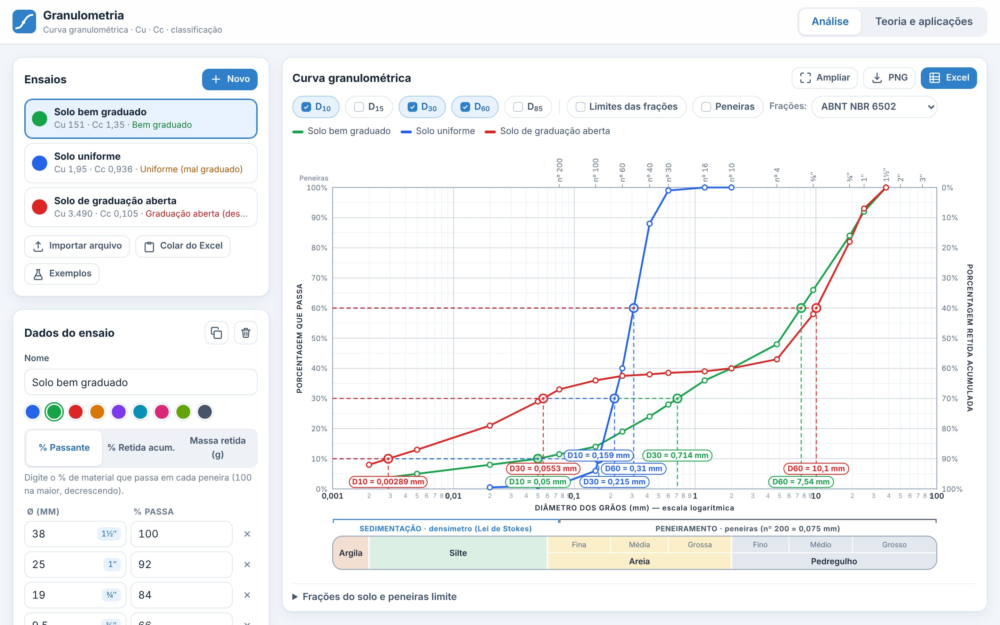
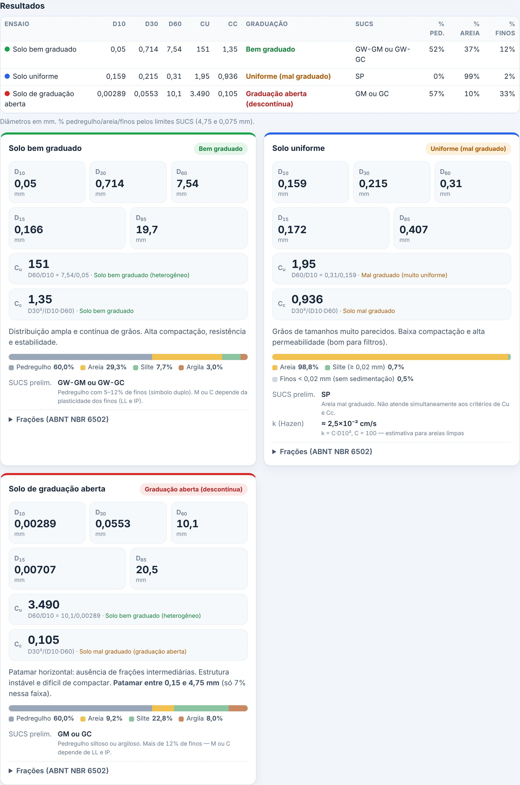
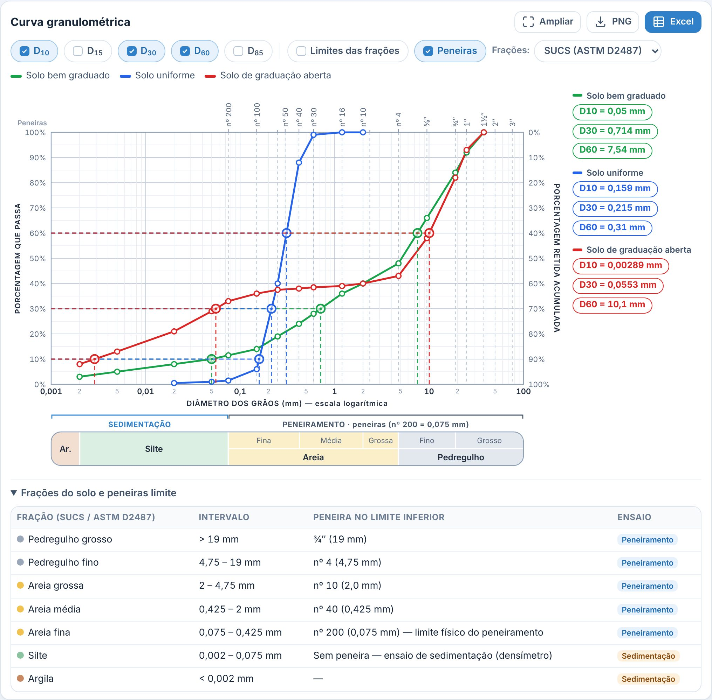
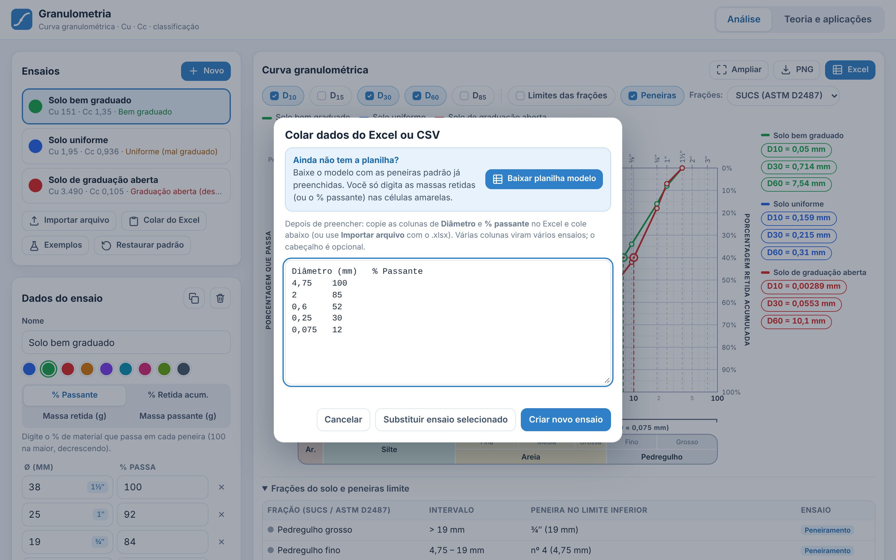
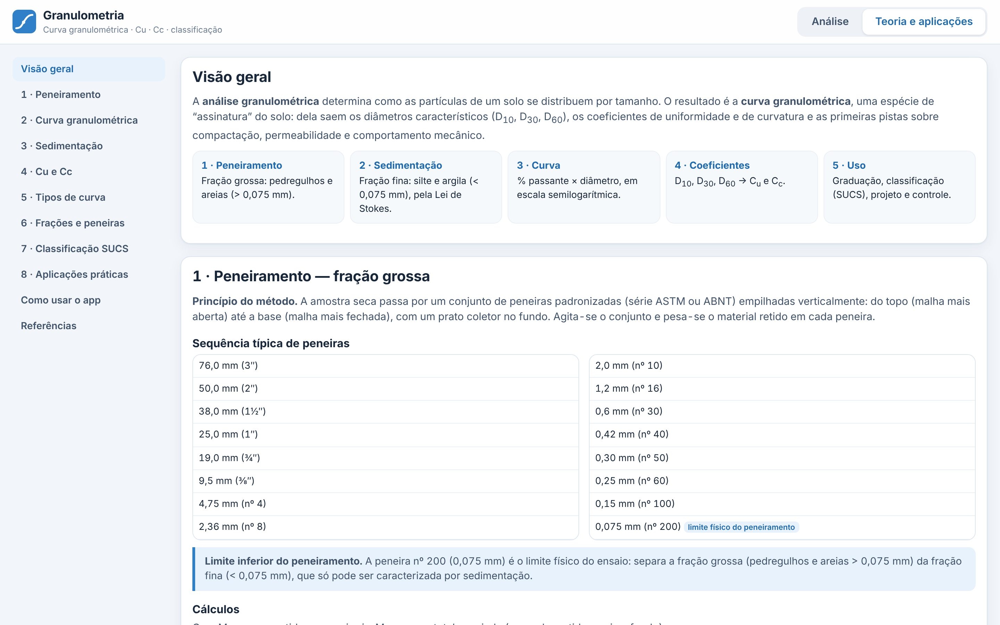
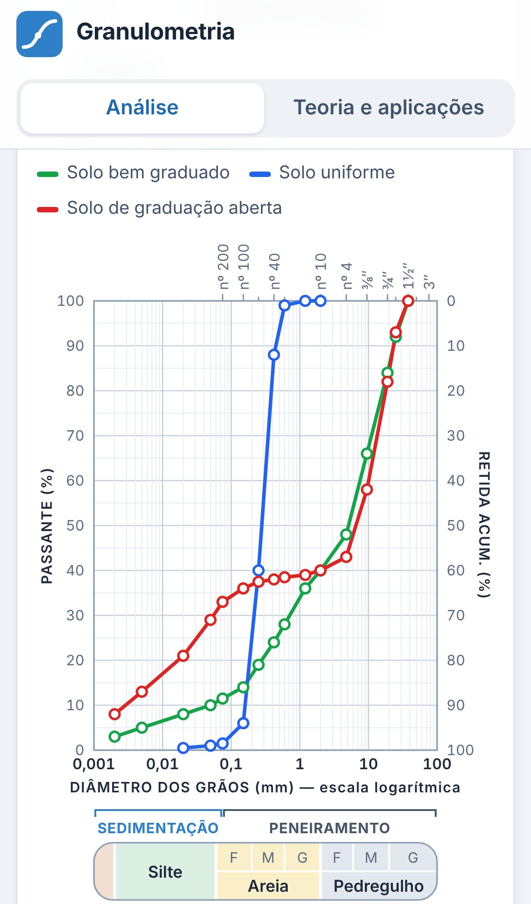
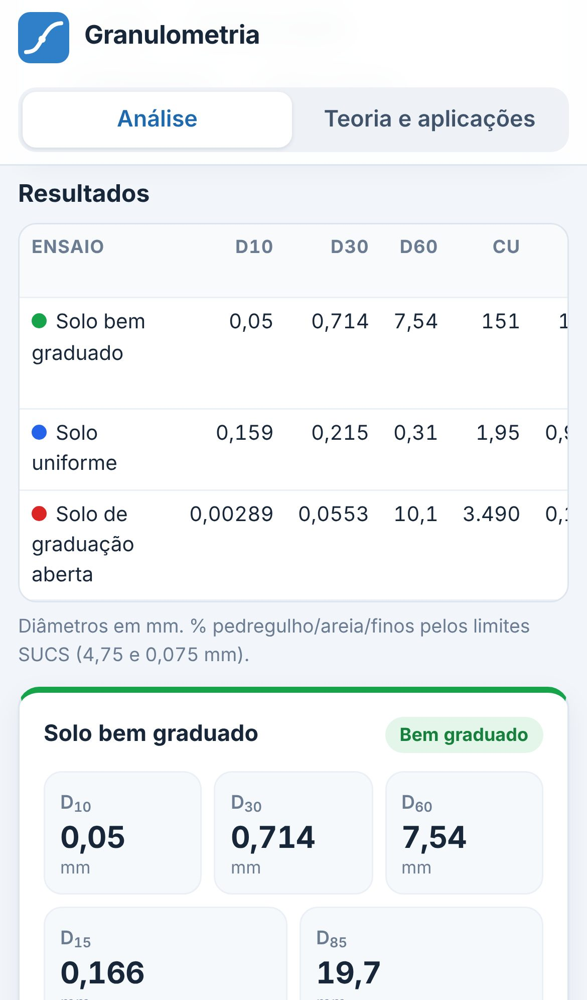

# Granulometria

**Da tabela de peneiras à classificação do solo em segundos.** Cole os resultados do ensaio direto do Excel e o app traça a curva granulométrica, calcula D10, D30, D60, Cu e Cc, separa as frações e sugere a classificação SUCS, tudo pronto para ir ao relatório.

Funciona **no navegador e no celular, sem instalar nada e sem internet**: é um arquivo `index.html` só, que também pode ser instalado como app na tela inicial.



### Por que usar

- **Sem digitar de novo:** cole a tabela do Excel ou importe `.xlsx`, `.csv` ou `.txt`, com % passante, % retida acumulada ou massa retida.
- **Planilha modelo pronta:** baixe um Excel com as peneiras padrão já preenchidas; é só digitar as massas retidas e o % passante sai calculado.
- **Curva profissional:** escala logarítmica, peneiras ASTM no topo, % retida acumulada no eixo da direita, faixas de sedimentação e peneiramento e D10/D15/D30/D60/D85 marcados no gráfico, com os valores listados ao lado (e no PNG exportado).
- **Coeficientes e diagnóstico:** Cu, Cc e graduação (bem graduado, uniforme ou graduação aberta) com a fórmula aplicada e a interpretação do resultado.
- **Classificação e frações:** frações pela ABNT NBR 6502 ou pelo SUCS (ASTM D2487), SUCS preliminar e estimativa de permeabilidade (Hazen) para areias limpas.
- **Vários ensaios no mesmo gráfico:** compare amostras lado a lado, cada uma com sua cor.
- **Pronto para o relatório:** exporte o gráfico em PNG ou uma planilha Excel com dados, coeficientes e gráfico.
- **Aula embutida:** a aba Teoria explica peneiramento, sedimentação, Cu e Cc, tipos de curva, SUCS e aplicações práticas.

### Telas

| | |
|---|---|
|  |  |
| **Resultados:** tabela-resumo e um cartão por ensaio com coeficientes, frações e SUCS. | **Frações SUCS e peneiras:** troque o sistema de frações e veja as peneiras limite. |
|  |  |
| **Colar do Excel:** baixe a planilha modelo, preencha e cole; o ensaio é criado em um clique. | **Teoria e aplicações:** o conteúdo da aula, do peneiramento à classificação SUCS. |

**No celular:**

| | |
|---|---|
|  |  |

*Prints feitos com os 3 ensaios de exemplo do próprio app (botão **Exemplos**). Para refazer depois de mudar o visual: `node tools/prints.mjs`.*

## Usar localmente
Dê duplo clique em `index.html` (funciona offline, no computador e no celular).

## Publicar no GitHub Pages
1. Crie um repositório e envie estes arquivos (na raiz): `index.html`, `manifest.webmanifest`, `sw.js`, `icons/`.
2. No GitHub: **Settings → Pages → Build and deployment → Deploy from a branch → `main` / `(root)`**.
3. Acesse `https://SEU-USUARIO.github.io/NOME-DO-REPO/`. No celular, use "Adicionar à tela inicial" para instalar como app (PWA).

## Editar o código
O código-fonte fica em `src/`. Depois de editar, gere o `index.html` novamente:

```
node build.mjs
```

Testes do núcleo de cálculo e do Excel: `node tests/core.test.js` e `node tests/xlsx.test.js`.

Prints do README: `node tools/prints.mjs` (gera `docs/screenshots/`; precisa do Playwright, veja o topo do script).

## Formato de importação
Diâmetro (mm) na 1ª coluna; nas demais, % passante, % retida acumulada ou massa retida (g). O cabeçalho indica o tipo
("% Retida…", "Massa retida (g)"); sem cabeçalho, assume % passante. Várias colunas = vários ensaios.
